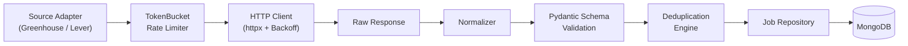

# Resilient Job Ingestion Service

A production-minded, source-abstracted job ingestion system built with **FastAPI**, **httpx**, **Pydantic v2**, **PyMongo**, and **MongoDB** (local or Atlas).

Designed and Maintained the best prioritizing reliability, rate pacing, exponential backoff, schema normalization, deduplication, and low-risk Terms-of-Service compliance.

**Note - Internet connection is required for ingestion service.**
---

## 🌟 Key Architectural Features

- **Source Abstraction**: Decoupled `JobSource` interface isolating upstream vendor logic.
- **Primary & Fallback Sources**:
  - **Primary**: `GreenhouseSource` (`https://boards-api.greenhouse.io/v1/boards/{board_token}/jobs`)
  - **Fallback**: `LeverSource` (`https://api.lever.co/v0/postings/{company}`)
- **Resilient HTTP Transport**:
  - Async `TokenBucketRateLimiter` for request pacing (default: 2.0 req/s).
  - Bounded exponential backoff with uniform jitter.
  - Automatic `Retry-After` header parsing (supports integer seconds and RFC 7231 HTTP-date).
  - Categorized error handling (retryable `429/5xx` vs non-retryable `400/401/403/404`).
- **Failure Taxonomy**: Distinguishes `SUCCESS`, `FALLBACK_SUCCESS`, `PARTIAL`, `FAILED`, and `EMPTY_RESPONSE`.
- **Database Deduplication**: Unique compound index `(source_id, external_id)` in MongoDB.
- **MongoDB Validation Rules**: `$jsonSchema` validators on all three collections.
- **Aggregation Insights**: jobs per company/source/location, run reliability, monthly trend (`/api/analytics`).
- **Login System**: signup, login, logout, forgot password (security question), edit profile, change password, delete own account.
- **Per-user data**: every job and ingestion run belongs to the user who made it; users can never see each other's data.
- **Admin dashboard** (`/admin`): see users, delete users, see everyone's ingestions, clear one user's ingestions, clear all ingestions.
- **Lean user page**: search, fallback checkbox, jobs page by page (10 per page), "Welcome, name", theme switch (dark/light), log out.
- **Applied tracking**: press *Apply* on a job (opens the job page and records it); the **Applied** tab lists previous applications, latest first, with *Undo*.
- **Bulk delete**: tick jobs (or "Select all on this page") and delete the selection; the button shows how many are selected.
- **Posted-in filter when fetching**: Any time / last 7 days / 1 month / 2 months / 6 months / 1 year, so old jobs are not brought back.
- **Full Observability**: Every ingestion run logs an immutable audit trail in `ingestion_runs`.
- **Server-Rendered Console**: Lightweight Jinja2 + Vanilla CSS/JS operational dashboard.

---

## 🏗️ Conceptual Architecture



---

## 🛠️ Technology Stack

| Layer | Technology |
|---|---|
| **Language** | Python 3.12+ |
| **Framework** | FastAPI + Uvicorn |
| **HTTP Client** | httpx (AsyncClient) |
| **Validation** | Pydantic v2 + Pydantic-Settings |
| **Database** | MongoDB + PyMongo |
| **Frontend Dashboard** | Jinja2 + Vanilla CSS & JavaScript |
| **Testing** | pytest + pytest-asyncio + respx |

---

## 🚀 Quickstart Guide

### 1. Prerequisites
- Python 3.12+ installed.
- A MongoDB server (local `mongod` or a free MongoDB Atlas cluster).

### 2. Clone & Setup Environment

```bash
# 1. Clone repository
cd d:/acdyon

# 2. Create virtual environment
python -m venv venv

# 3. Activate virtual environment
# Windows PowerShell:
.\venv\Scripts\Activate.ps1
# Linux/macOS:
source venv/bin/activate

# 4. Install dependencies
pip install -r requirements.txt
```

### 3. Environment Configuration

Copy `.env.example` to `.env`:

```bash
cp .env.example .env
```

```env
# Application Settings
ENVIRONMENT=development
LOG_LEVEL=INFO
PORT=8000
HOST=0.0.0.0

# MongoDB Connection
MONGODB_URI=mongodb://localhost:27017
# Atlas: mongodb+srv://<user>:<password>@<cluster>.mongodb.net/?retryWrites=true&w=majority
MONGODB_DB=job_ingestion

# Login
SESSION_DAYS=7
ADMIN_EMAIL=admin@example.com        # admin account is created at startup when both are set
ADMIN_PASSWORD=choose-a-strong-password

# Ingestion Pacing & Resilience
DEFAULT_RATE_LIMIT_RPS=2.0
HTTP_TIMEOUT_SECONDS=15.0
HTTP_MAX_RETRIES=3
HTTP_INITIAL_BACKOFF_SECONDS=1.0
HTTP_MAX_BACKOFF_SECONDS=8.0
```

### 4. Run Migrations

```bash
python migrations/run_migrations.py
```

### 5. Launch Application Server

```bash
uvicorn app.main:app --reload --host 0.0.0.0 --port 8000
```

Open your browser and navigate to:
- **Interactive Dashboard**: [http://localhost:8000](http://localhost:8000)
- **Interactive OpenAPI Docs**: [http://localhost:8000/docs](http://localhost:8000/docs)

---

## 🧪 Running Automated Tests

The test suite runs with 100% network isolation (mocked HTTP transports) and an in-memory MongoDB (`mongomock`), so no database server is needed. Zero external network calls are made during test execution.

```bash
pytest -v
```

### Test Coverage Highlights:
- `tests/test_adapters.py`: Greenhouse & Lever payload extraction and normalization.
- `tests/test_normalizer.py`: Field sanitization, whitespace trimming, and missing field rejection.
- `tests/test_rate_limiter.py`: Token bucket capacity, refill timing, and concurrency safety.
- `tests/test_retry.py`: Exponential backoff math, jitter bounds, and `Retry-After` parsing.
- `tests/test_http_client.py`: 429 backoff, 5xx server errors, 404 fast-fail, and timeouts.
- `tests/test_fallback.py`: Primary failure failover to Lever and empty response detection.
- `tests/test_deduplication.py`: Unique index and duplicate tracking lifecycle.
- `tests/test_validation_rules.py`: `$jsonSchema` rules accept good and reject bad documents.
- `tests/test_crud_and_analytics.py`: CRUD, show-all-records and aggregation pipelines.
- `tests/test_api.py`: `/health`, `/api/ingest`, `/api/jobs`, `/api/sources`, `/api/runs`, and dashboard view.

---

## 📡 REST API Reference

### 1. Service Health
- **Endpoint**: `GET /health`
- **Response**:
```json
{
  "status": "ok",
  "timestamp": "2026-08-19T10:00:00Z",
  "database": "healthy",
  "sources": {
    "greenhouse": { "healthy": true, "latency_ms": 145.2, "message": "Greenhouse API is responsive." },
    "lever": { "healthy": true, "latency_ms": 162.8, "message": "Lever API is responsive." }
  }
}
```

### 2. Trigger Ingestion
- **Endpoint**: `POST /api/ingest`
- **Request Body**:
```json
{
  "source": "greenhouse",
  "board_token": "cloudflare",
  "allow_fallback": true
}
```
- **Response**:
```json
{
  "run_id": "70cd709e-4039-444b-bacf-356e34eada78",
  "source_name": "greenhouse",
  "fallback_used": false,
  "status": "SUCCESS",
  "fetched_count": 42,
  "valid_count": 42,
  "invalid_count": 0,
  "new_count": 42,
  "duplicate_count": 0,
  "failed_count": 0,
  "duration_ms": 680,
  "started_at": "2026-08-19T10:00:00Z",
  "finished_at": "2026-08-19T10:00:01Z"
}
```

### 3. List Normalized Jobs
- **Endpoint**: `GET /api/jobs?search=engineer` returns **all** matching jobs. Add `&limit=20&page=1` for pagination.
- Also: `GET /api/jobs/{id}`, `PATCH /api/jobs/{id}` (use `{"applied": true}` to mark applied), `DELETE /api/jobs/{id}`, `POST /api/jobs/bulk-delete` with `{"ids": [...]}` (up to 100), and `GET /api/jobs?applied=true`.
- `POST /api/ingest` accepts `posted_within_days` (7, 30, 60, 180, 365 or empty).
- **Response**:
```json
{
  "items": [
    {
      "id": "c3e98161-073c-41ad-a0d0-4bf691adad89",
      "source_id": "greenhouse",
      "source_name": "greenhouse",
      "external_id": "1001",
      "title": "Senior Infrastructure Engineer",
      "company": "Cloudflare",
      "location": "Austin, TX / Remote",
      "job_url": "https://boards.greenhouse.io/cloudflare/jobs/1001",
      "posted_at": "2026-08-01T12:00:00Z",
      "created_at": "2026-08-19T10:00:01Z",
      "updated_at": "2026-08-19T10:00:01Z"
    }
  ],
  "total": 1,
  "page": 1,
  "limit": 20,
  "pages": 1
}
```

### 4. Sources Status
- **Endpoint**: `GET /api/sources`

### 5. Ingestion Audit Runs
- **Endpoint**: `GET /api/runs` returns all runs (optional `?limit=N`).

### 6. Aggregation Analytics

- **Endpoint**: `GET /api/analytics`

---

## 🔒 Compliance & Terms of Service Statement

This application strictly interfaces with **public job feeds and open ATS board APIs** (Greenhouse & Lever). It contains:
- ❌ **NO** CAPTCHA bypass mechanisms
- ❌ **NO** scraping behind authentication walls (LinkedIn, Indeed)
- ❌ **NO** credential theft or session automation
- ❌ **NO** stealth browser anti-bot evasions

All architectural questions and technical trade-offs are documented in [DECISIONS.md](file:///d:/acdyon/DECISIONS.md).
